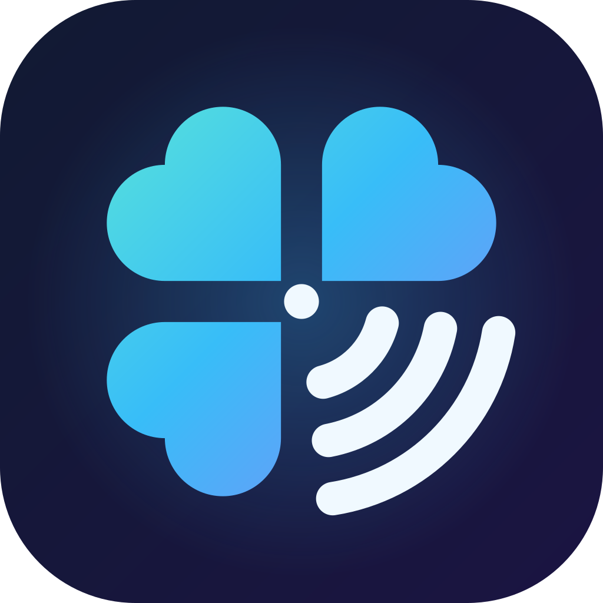

<p align="center">
  
</p>

# LuckyMatch

Free, open-source, real-time song recognition and live synchronized (line & syllable-level) lyrics engine written in Rust.

## Downloads

Pre-built binaries for **Windows (x64)** and **Android (APK)** are published on the [GitHub Releases](https://github.com/ImLuckyWiz/LuckyMatch/releases) page.

## Architecture

- `crates/luckymatch-core` — 100% portable Rust core (Windows, Android, Linux, macOS). Uses pure-Rust `rustls` + `ring` (zero OpenSSL) and host-injected storage paths:
  - Audio downmix & resampling to mono 16 kHz `i16`
  - Local Shazam audio fingerprinting (`shazamio-core`, MIT) + Shazam v5 recognition with `offset` & `timeskew` extraction
  - Spotify Client Credentials ISRC/text lookup -> Spotify Track ID + duration
  - 6-tier lyrics waterfall (`Custom` -> `Cache` -> `Spicy Lyrics` -> `AMLL TTML DB` -> `NetEase YRC/LRC` -> `LRCLIB`) with TTML (including `x-bg` background vocals & `x-roman`), YRC, and LRC parsers
  - `PlaybackClock` with capture-anchor timing, `±0.2s` nudge, pause/resume, and re-sync
- `crates/luckymatch-ffi` — UniFFI bindings (`cdylib` + `staticlib`) exposing `LuckyMatchClient` for Android (Kotlin / Jetpack Compose).
- `crates/luckymatch-desktop` — Native Windows GPUI desktop & floating overlay app with WASAPI capture, album-art accent tinting, and smooth syllable-level karaoke.
- `crates/luckymatch-cli` — Windows CLI & terminal karaoke client supporting WASAPI system loopback, microphone capture, `.wav` file input, and direct lyrics lookup.
- `android/` — Native Android app (Kotlin / Jetpack Compose) loading `libluckymatch_ffi.so` via UniFFI, supporting Microphone and Android 10+ Internal Audio (`AudioPlaybackCapture`).

## Configuration

Copy `config.example.json` to `config.json` (git-ignored) and fill in your credentials, or set environment variables:

- `SPOTIFY_CLIENT_ID`
- `SPOTIFY_CLIENT_SECRET`
- `SPICY_LYRICS_API_KEY`

Without Spotify/Spicy credentials, Shazam recognition, NetEase (`YRC`), and LRCLIB (`LRC`) still work automatically.

## Desktop App (GPUI)

```bash
cargo run -p luckymatch-desktop
```

### Desktop Controls
- `R` — Identify / re-sync now
- `[` / `]` — Nudge sync `-0.2s` / `+0.2s` (`0` resets to `0.0s`)
- `Space` — Pause / resume clock
- `O` — Toggle Compact Overlay / Full mode
- `T` — Toggle Always-on-Top pin
- `M` — Toggle System Audio (WASAPI Loopback) / Microphone
- `A` — Toggle Auto-Sync

## Android App (Kotlin / Jetpack Compose)

1. Cross-compile `luckymatch-ffi` (`.so` libraries for `arm64-v8a` and `x86_64`) and regenerate UniFFI Kotlin bindings:
   ```powershell
   powershell -ExecutionPolicy Bypass -File scripts/build-android-rust.ps1
   ```
2. Build the debug APK (requires JDK 17+, e.g. Android Studio's JBR):
   ```powershell
   $env:JAVA_HOME = "C:\Program Files\Android\Android Studio\jbr"
   cd android
   .\gradlew.bat :app:assembleDebug
   ```
   Output APK: `android/app/build/outputs/apk/debug/app-debug.apk`

## CLI Usage

```bash
# Live system loopback capture (default 5s) + terminal karaoke
cargo run -p luckymatch-cli -- listen

# Capture from microphone
cargo run -p luckymatch-cli -- listen --source mic --seconds 5

# Identify a WAV file and play synced karaoke
cargo run -p luckymatch-cli -- file path/to/song.wav --start-sec 0 --seconds 6

# Fetch & print/preview lyrics directly
cargo run -p luckymatch-cli -- lyrics --title "Blinding Lights" --artist "The Weeknd"
```

### Karaoke Controls
- `[` / `]` — nudge sync `-0.2s` / `+0.2s`
- `Space` — pause / resume clock
- `r` — re-sync (re-capture & re-anchor clock)
- `q` / `Esc` — quit
